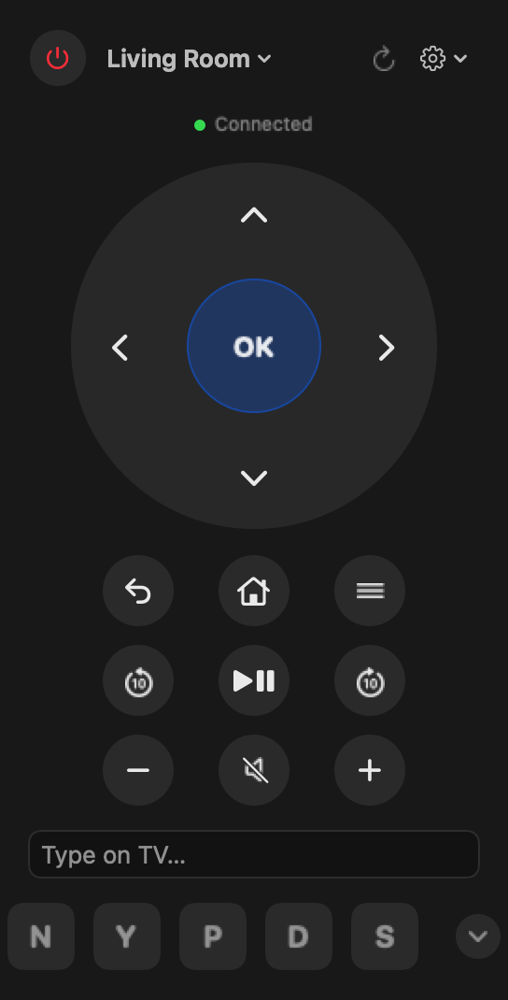
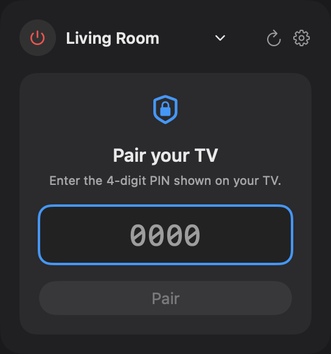
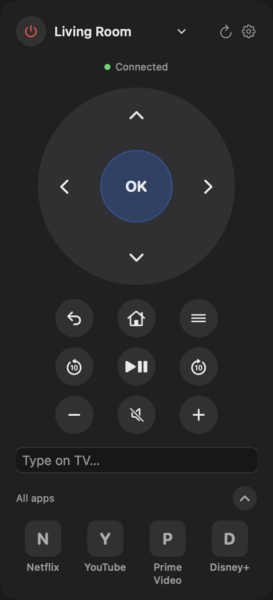
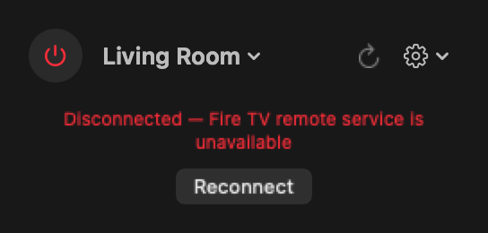
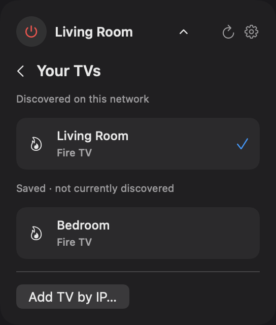
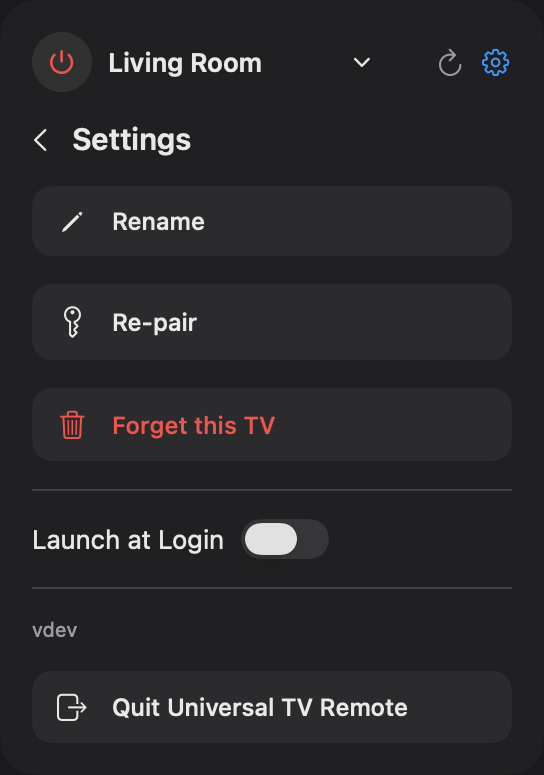

# Universal TV Remote for Mac

A native macOS menu-bar remote for **Fire TV, Android / Google TV, Samsung
Tizen, LG webOS, and Roku**. Open the TV icon in the menu bar to control a
TV on your local network.

## Screenshots

Connected, pairing, expanded apps on a shorter screen, and disconnected
states, captured from the actual SwiftUI views using an offline demo device.
Demo app tiles use letter placeholders.

<p>
  
  
</p>
<p>
  
  
</p>

<details>
<summary>TV selection and settings inside the same window</summary>
<p>
  
  
</p>
</details>

## Features

- **Automatic discovery and remembered TVs:** Bonjour and SSDP find TVs on
  your local network. Known devices appear immediately at startup. Fire TV
  service changes and multiple discovery protocols merge into one entry;
  existing duplicates are cleaned up while keeping pairing credentials,
  custom names, and the selected TV. The picker separates **Discovered on
  this network** from **Saved · not currently discovered**, so remembered
  devices are not presented as current discoveries. Discovery refreshes
  periodically; SSDP sightings expire after 45 seconds without a new reply.
- **Automatic connection:** restores the last selected, already paired TV
  at launch and follows discovery updates when its IP address changes.
  A single paired TV can be selected automatically. New TVs require an
  explicit selection to begin pairing.
- **Live connection status:** Fire TV and Roku use read-only checks every
  three seconds with a two-second request timeout. They recover automatically
  when the service returns. Other brands report control-channel failures
  and retry previously paired connections. **Reconnect** appears only while
  disconnected or after a connection failure.
- **Full remote:** power, a ring direction pad with OK, back/home/menu,
  play/pause, rewind/fast-forward, skip controls, volume, and mute.
- **Text input:** type in the remote's field and press Return to send text
  to the focused input on your TV.
- **App shortcuts:** common apps appear immediately; Fire TV, Roku, and LG
  fetch installed apps, while Samsung checks its supported app catalog.
  Expand the shortcut row to browse more apps. Android TV uses a curated
  list of deep links.
- **Keyboard shortcuts:** while the remote is open and its text field is
  not focused, arrows navigate; Return selects; Escape/Delete go back;
  Space plays/pauses; `h` opens Home; `m` mutes; `+`/`-` adjust volume.
  Remote buttons flash when a keyboard shortcut fires. System media keys
  continue to control your Mac.
- **Device management:** rename TVs, clear a nickname, re-pair, forget a TV,
  or add one manually by IP address or hostname. TV selection, settings,
  pairing, rename, and add-TV forms all stay inside the remote window;
  no separate dropdown panels or dialogs are used.
- **Launch at Login:** enable it from the settings menu.
- Compact dark SwiftUI popover with immediate button presses and a pinned
  header when the app list expands. The panel fits its screen, scrolls long
  content, and shrinks to a centered pairing card during re-pairing. No cloud
  account or ADB required.
  App expansion updates the panel directly without a layout animation that
  briefly collapses the remote.

## Install

Download `Universal.TV.Remote.for.Mac.zip` from [Releases](../../releases),
unzip it, move **Universal TV Remote.app** to `/Applications`, and
**right-click → Open** on the first launch. Requires **macOS 14 or later**.
The app is ad-hoc signed, not notarized.

Allow local network access when macOS asks. If discovery is blocked, enable
it in **System Settings → Privacy & Security → Local Network**. Your Mac
and TV should normally be on the same network; use **Add TV by IP…** when
automatic discovery cannot reach the TV.

Select a TV to pair. Fire TV shows a four-digit PIN; Android TV shows a
six-character code. Samsung and LG show an Allow/Deny prompt on the TV.
Roku does not require pairing. Credentials are remembered for later use.

## Connection status and power

“Connected” means the TV's **remote service** is reachable, rather than a
measurement of the display's power state. A separately powered Fire TV
Stick can remain reachable when its attached television is off. Fire TV
and Roku status changes normally appear within a few seconds of a service
becoming unreachable, subject to system sleep and network delays. Fire TV
can take up to about seven seconds when a failed remote check is followed
by the read-only DIAL service check.

Automatic connection, monitoring, and Fire TV reconnection do **not** send
wake commands. Use the power button explicitly to wake or sleep the TV.
An unavailable TV stays disconnected with a **Reconnect** button. A revoked
Fire TV token requires **Settings → Re-pair**.

If a Fire TV is on but cannot connect, the app reads its DIAL service status.
When `FireTVRemote` is stopped, it explains that the remote service needs
to be started. The power button explicitly starts/wakes that service;
background checks and **Reconnect** never start it automatically.

## Per-brand notes

| Brand | Protocol | Pairing | Power-on |
|---|---|---|---|
| Fire TV | Local REST API (`8080`) | Four-digit PIN | DIAL wake (`8009`) |
| Android / Google TV | Remote v2 TLS (`6466` / `6467`) | Six-character code | Protocol power key |
| Samsung Tizen | WebSocket (`8002`) | Allow on TV | Wake-on-LAN with a cached MAC |
| LG webOS | SSAP WebSocket (`3001`) | Allow on TV | Wake-on-LAN with a cached MAC |
| Roku | ECP REST (`8060`, or advertised port) | None | ECP / fast-start |

- Fire TV supports Bonjour and Amazon-confirmed DIAL discovery. Some old
  firmware lacks the local remote API. The power button toggles sleep/wake
  based on remote-service reachability.
- Roku OS 14.1+ may require **Settings → System → Advanced system settings
  → Control by mobile apps → Enabled**.
- Samsung, LG, and Roku drivers have not been verified on physical hardware
  by the developer. Available controls and power behavior vary by model.
- Android TV text input sends characters individually; uppercase and some
  unusual characters are skipped.
- App-list queries vary by firmware. A static catalog is used when an
  installed-app endpoint is unavailable.

## Build and verify

Requires Xcode command-line tools with Swift 5.9 or later. The Android TV
protocol dependency is vendored locally under `Vendor/AndroidTVRemoteControl`.
The regression tests use Swift Testing and require Swift 6 or later.

```bash
git clone https://github.com/devasheeshG/universal-tv-remote-macos.git
cd universal-tv-remote-macos
swift test
bash scripts/build-app.sh
```

The app bundle is written to `build/Universal TV Remote.app`. Tests use
isolated preferences and intercepted network requests; they do not send
commands to real TVs. To regenerate the README screenshots from the actual
app views with an offline demo driver:

```bash
README_SCREENSHOTS="$PWD/docs/screenshots" swift test --filter ScreenshotTests
```

If the installed beta macOS SDK lacks its SwiftUI macro plugin, select a
complete SDK explicitly, for example:

```bash
swift test --sdk /Library/Developer/CommandLineTools/SDKs/MacOSX26.5.sdk
```

## CI/CD

Every push to `main` runs tests, builds on a macOS runner, and publishes a
GitHub Release (`v1.0.<run>`) with the zipped app attached. A `v*` tag creates
an explicitly versioned release. See
[release.yml](.github/workflows/release.yml).

## Architecture

`App.swift` owns the menu-bar interface and selection restoration;
`Discovery.swift` handles discovery, identity merging, and remembered-device
migration. `TVController.swift` defines device models, session state,
credential storage, reconnect handling, and the shared driver protocol.
Each brand has its own driver file. Tests cover duplicate migration,
credential preservation, Fire TV connection monitoring, and offline
screenshot generation.

## License

MIT. The vendored AndroidTVRemoteControl library is MIT, © Roman Odyshew.
